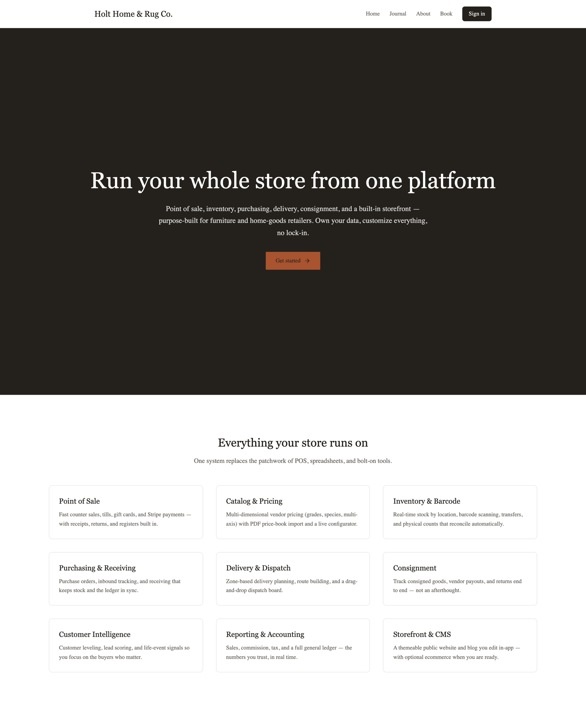
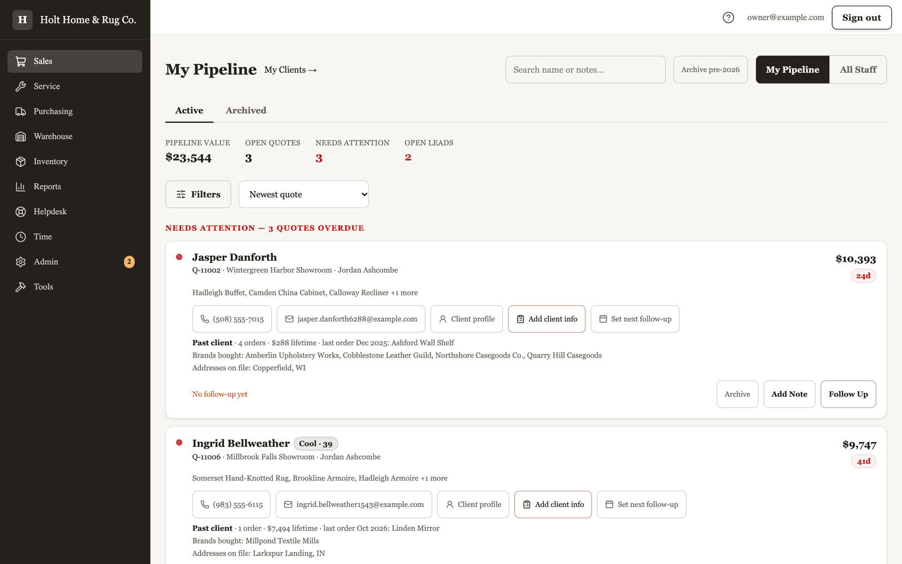
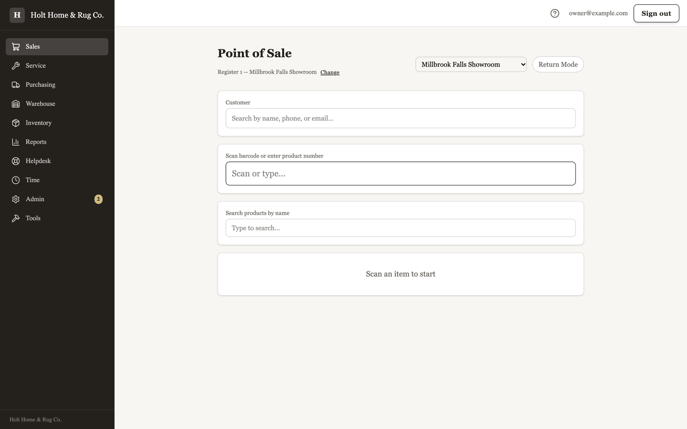
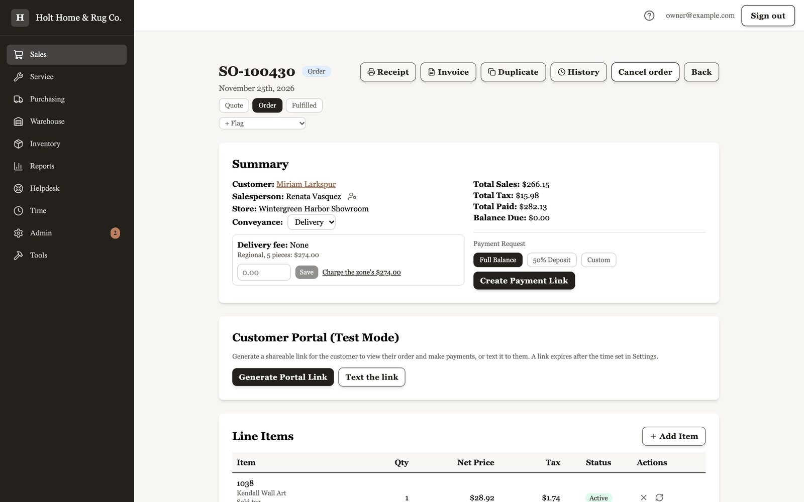
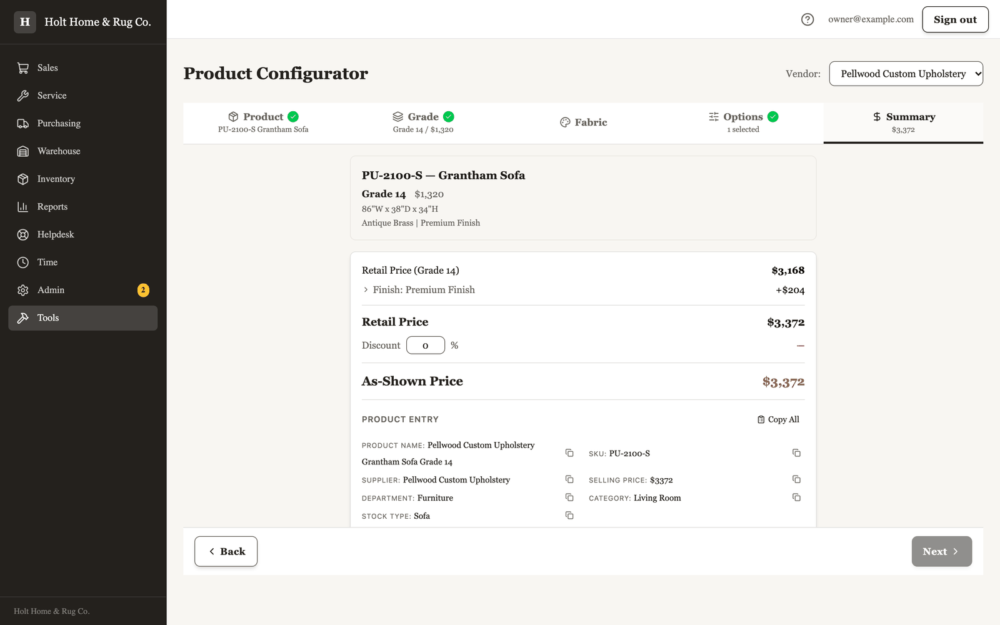
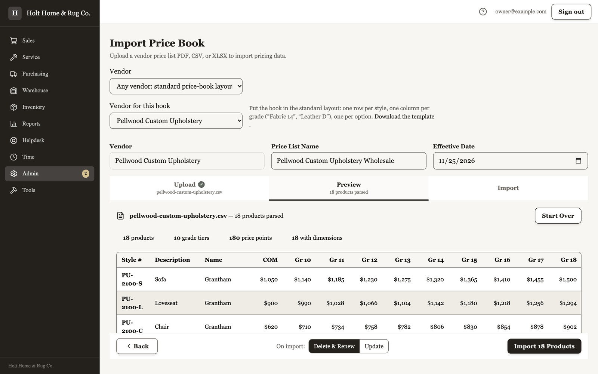
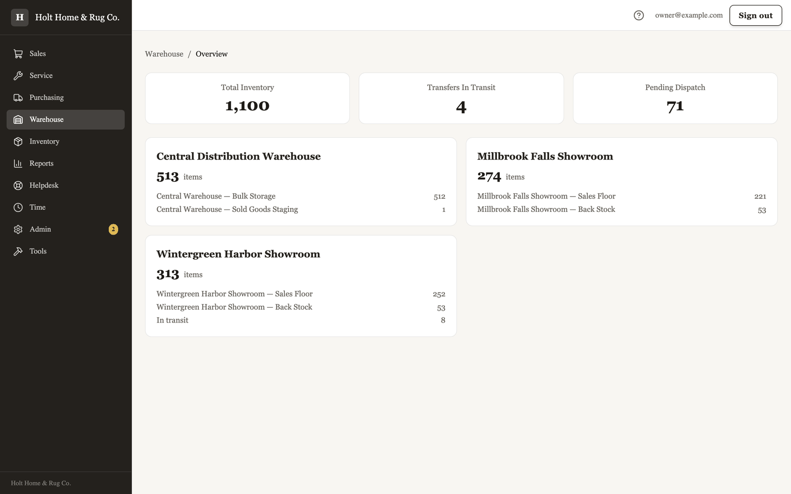
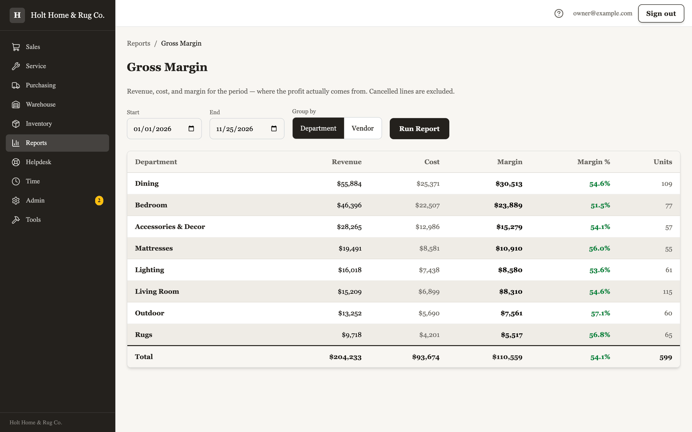

# Holt

[](https://github.com/goetchstone/holt/actions/workflows/ci.yml)
[](https://github.com/goetchstone/holt/actions/workflows/security.yml)
[](https://github.com/goetchstone/holt/security/code-scanning)
[](https://scorecard.dev/viewer/?uri=github.com/goetchstone/holt)
[](LICENSE)

> **Use at your own risk.** Holt is an independent project under active
> development. It is not affiliated with, endorsed by, or supported by any
> other company, and it is provided **as is, without warranty of any kind**
> (see [LICENSE](LICENSE)). It handles money, inventory and tax. Evaluate it
> against your own books before you trade on it.

Holt is a business management platform for furniture and home-goods retailers.
It covers the whole operation in one system: product catalog and multi-dimensional
pricing, inventory and consignment, sales and purchasing, service dispatch, staff
scheduling, customer intelligence, and reporting.

It runs as **two surfaces from one codebase**: a public, themeable **storefront /
marketing site** powered by a built-in block-based **CMS** (managed in-app, no
rebuilds) at `/`, and the authenticated **back-office** at `/app`. Which modules a
deployment exposes is configured per-organization via feature flags
(Admin → Settings → Modules).

Holt is **open-core**, and every business runs its own deployment: its own
database and its own containers, on a cloud account, a VPS or a server on site.
Many businesses means many deployments, never a shared database. One deployment
serves a business across all its stores. Where to host it and how big a server
it needs is in [docs/HOSTING.md](docs/HOSTING.md).

Branding, integration credentials, and import mappings are configured in the
database through the in-app Settings screens. A deployment is white-labeled and
wired to its own systems without editing code.

## What it looks like

The screenshots below are a live instance running the demo seed (`npm run setup`):
two showrooms and a warehouse, about 500 orders, 180 customers and 220 products
over eighteen months. No mockups.

### Storefront

A public site with a built-in block CMS, edited in-app with no rebuild. Its
colours and type come from the deployment's theme in Admin → Settings.



### Selling

Each salesperson's pipeline: open quotes with the client's history, what needs
attention, and the next follow-up.



The point of sale scans or searches products at the register; tills, receipts,
returns and card payments are built in.



An order shows what is owed and paid and how it gets to the customer, and sends
them a payment link or a portal link to follow it.



### Special orders

The configurator prices a made-to-order piece on the floor: pick the style, the
fabric or leather grade and the options, and it shows the retail price worked
out from the vendor's price book and the store's own markup.



Those prices come from the vendor's own price book. The import reads a PDF, CSV
or XLSX: the vendor formats it already knows are read directly, and any other
vendor's book goes in through a standard layout, one row per style and one
column per grade. Nothing is written until the parsed book has been previewed.



### Operations

Stock by store and by place within it, transfers in transit, and deliveries
waiting for dispatch.



### Reporting

More than forty reports cover the money path end to end: margin, sell-through,
returns, commission, tax, and the reconciliation worklists that surface what is
off the books. Gross margin by department:



## Quick Start

From a fresh clone to a logged-in system with ~18 months of demo data:

```bash
cp env.example .env                      # database credentials
cp app/.env.local.example app/.env.local # then fill APP_ENCRYPTION_KEY + NEXTAUTH_SECRET

docker compose up db -d                  # Postgres only
cd app && npm install
npm run setup                            # migrate + seed demo data + seed CMS
npm run dev
```

Running `setup`/`dev` from your machine (as above) rather than inside a Compose
container? One gotcha, one setting:

- Put a real value on `POSTGRES_PASSWORD` in `.env` (that is what `docker compose
  up db` creates the database with) and the **same** value in
  `app/.env.local`'s `DATABASE_URL`.
- `app/.env.local`'s `DATABASE_URL` already points at `localhost:5433` — the port
  the default `db` service maps to. `env.example`'s `@db:` host only resolves
  inside Compose, so a host-side `npm run setup` needs the `localhost` form;
  `setup.sh` reads `app/.env.local` first, so that line is the one that matters.

Open <http://localhost:3000/auth/login> and sign in:

| | |
|---|---|
| Email | `admin@example.com` |
| Password | `Showroom2026!` |

Every seeded staff account shares that password; `owner@`, `manager.*@`,
`designer1@`, `register1@` and `warehouse1@` exist too, each with a different
role, which is the quickest way to see how permissions behave.

Two values in `app/.env.local` are **required** and easy to miss:

- `APP_ENCRYPTION_KEY` — the app refuses to start without it (≥16 chars;
  `openssl rand -base64 32`).
- `AUTH_LOCAL_ENABLED=true` — without it the password provider is not
  registered and the seeded accounts cannot sign in. Google OAuth is optional
  and not needed to evaluate the system.

Verify the whole path end to end at any time:

```bash
cd app && START=1 bash scripts/smoke.sh    # boots?, seeded?, can log in?, data loads?
```

`START=1` lets the script boot the app itself; drop it if you already have
`npm run dev` running. That script is also what CI runs (after `npm run build`),
so "it starts and a person can use it" is a gate rather than an assumption.

### Docker

```bash
docker compose --profile dev up      # hot-reload
docker compose up -d --build         # production build
```

A one-shot `migrate` service applies migrations before the app starts. The app
runs as `APP_REPLICAS` processes behind nginx (one by default) and has no host
port of its own: browsers reach it through nginx on 443 once TLS is set up
(docs/PRODUCTION.md §2), and the server's own jobs through a second nginx on
`127.0.0.1:8080`. To try the production image on your own machine before that,
`scripts/dev-app-up.sh` runs one process on <http://localhost:3000>. How big a
server and how many processes a business needs, and where to host it, is in
[docs/HOSTING.md](docs/HOSTING.md).

A production build served over plain http on localhost additionally needs
`ALLOW_INSECURE_NEXTAUTH_URL=true` — the https requirement is correct for a real
deployment and only relaxes for loopback addresses.

## Configuration

Three secrets live in the environment (`.env`) because they bootstrap the app
before the database is reachable:

- `DATABASE_URL` — Postgres connection string
- `NEXTAUTH_SECRET` — session signing key
- `APP_ENCRYPTION_KEY` — key that encrypts stored integration credentials

Everything else is configured at **Admin → Settings**:

- **Branding** — name, logo, favicon, colors (theme), tagline, support email
- **Integrations** — Stripe, Mailchimp, Google, and other provider keys, stored
  encrypted at rest and never returned to the browser in plaintext
- **Imports** — CSV column mappings; vendor/POS formats ship as reusable presets
  (`config/presets/`, YAML or JSON, editable in the admin UI or applied from git —
  see [config-presets](docs/domains/config-presets.md))

See `env.example` for the full environment template.

## Editions

- **Core** — catalog, pricing engine, sales, purchasing, customers, reporting,
  the CMS storefront (pages + navigation; blog is an optional module), and public
  booking with standard-calendar (.ics) invites + a staff iCal feed.
- **Premium (tiered)** — warehousing, dispatch and delivery planning,
  consignment, and the marketing/customer-intelligence suite. Premium modules
  are gated by the organization's plan.

## Development

```bash
cd app
npm run dev            # Start dev server
npm run validate       # Lint + typecheck (strict, whole tree) + format check
npm test               # Run unit tests
npm run build          # Production build — CI gates on it; catches server-only
                       # code pulled into a client bundle, which tsc cannot
npm run test:coverage  # Unit + integration coverage (gate input)
```

## Documentation

- [ARCHITECTURE.md](./ARCHITECTURE.md) — module map, data model, integrations
- [CONTRIBUTING.md](./CONTRIBUTING.md) — branch/PR workflow and quality gates
- [SUPPORT.md](./SUPPORT.md) — where to ask a question, report a problem or request
  a feature
- [OPERATIONS.md](./OPERATIONS.md) — deployment, monitoring, troubleshooting
- [docs/HOSTING.md](./docs/HOSTING.md) — where to host Holt, how big a server, and
  running it as more than one process
- [docs/DEPLOYMENTS.md](./docs/DEPLOYMENTS.md) — white-label model: product = code,
  a deployment = data (branding, theme, CMS content, env); per-tenant setup
- [docs/](./docs/) — deployment topology, CI, migrations, and domain runbooks

## Tech Stack

Next.js 16 (**App Router + tRPC**; all feature pages on App Router, REST API routes retained),
TypeScript 5.9, PostgreSQL 17, Prisma 7 (pg driver adapter), Node.js 24 LTS, NextAuth 4 (pluggable
Google/Okta/Azure/local), Tailwind CSS 4 + shadcn/ui, Docker Compose.

## History

This repository's history starts on 2026-10-07. Pull request numbers, issues
and commit SHAs cited in the docs from before then refer to a private archive.

## License

Holt is licensed under the **GNU Affero General Public License v3.0 or later**
(AGPL-3.0-or-later). You may run, study, modify, and self-host it freely; if you
offer a modified version to others over a network, you must make the corresponding
source available under the same license. See [LICENSE](./LICENSE) and the
attribution requirements in [NOTICE](./NOTICE).
